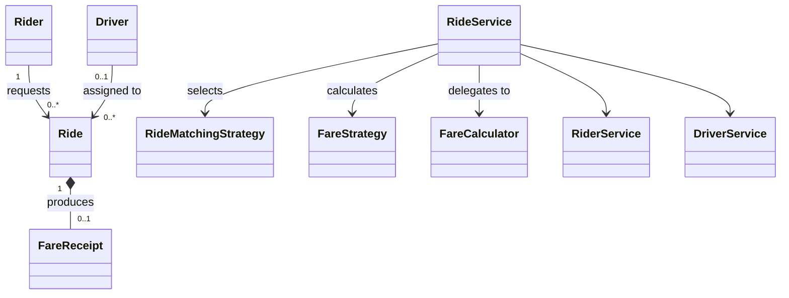

# Class Model

`Rider`, `Driver`, `Ride`, `FareReceipt`, `Location`, `RideStatus`, and `VehicleType` are domain types. Services own use-case coordination. Strategy interfaces isolate matching and fare policy. Repositories are service-facing interfaces backed by in-memory implementations in the MVP.
